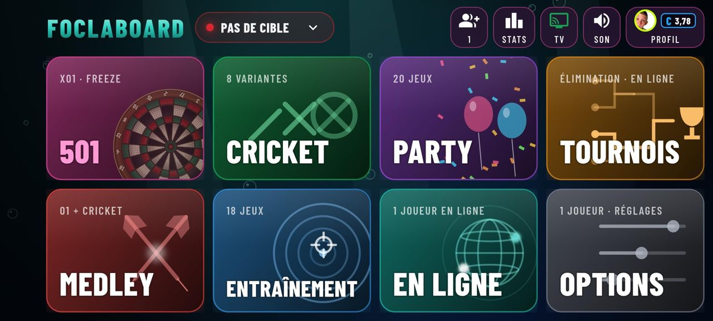
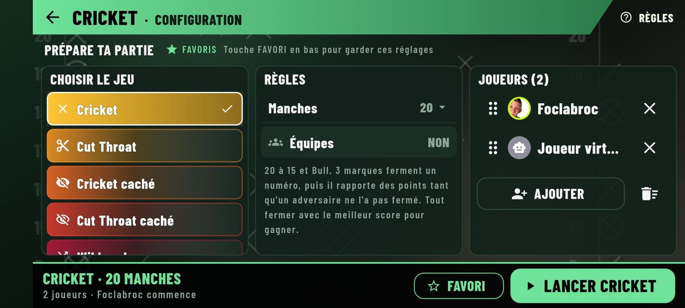
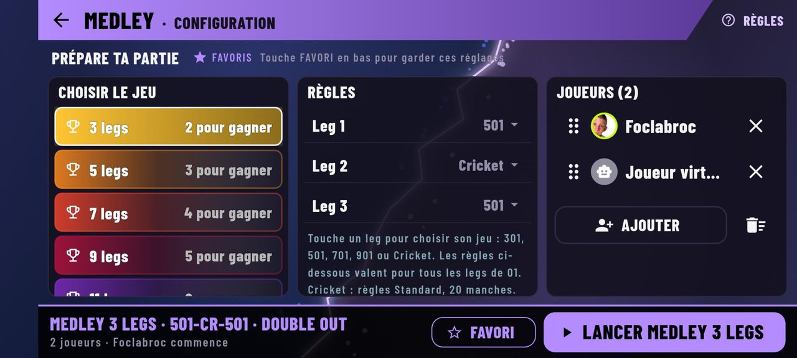
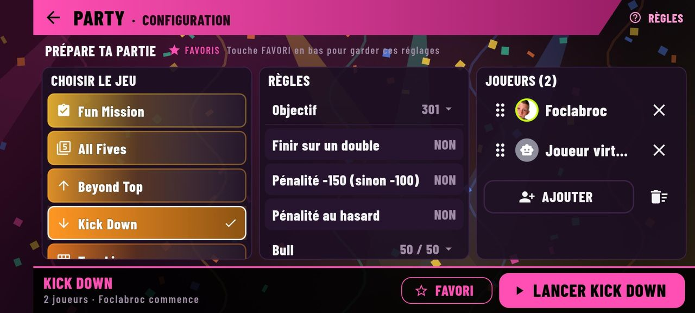
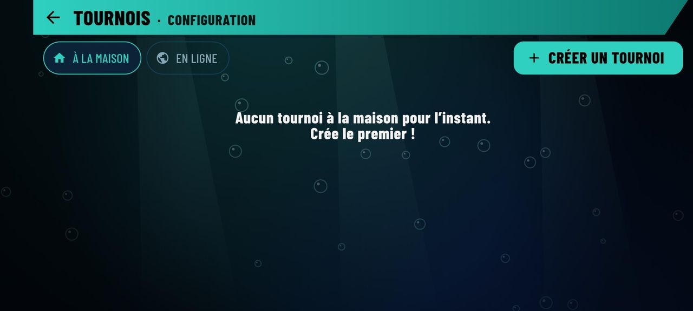

# Foclaboard

**Foclaboard** est une appli Android (Flutter) de fléchettes pour les cibles électroniques **GranBoard** (Dash et 3s), connectées en Bluetooth. Elle se joue en paysage, téléphone ou tablette posé à côté de la cible. Les comptes, stats, rangs et classements sont sur le serveur maison. Le même APK sert aussi d'écran sur une Android TV ou une tablette, et permet de jouer en ligne, chacun chez soi.

## Sommaire

- [Démarrer](#démarrer)
- [Les jeux](#les-jeux)
- [Préparer une partie](#préparer-une-partie)
- [Pendant la partie](#pendant-la-partie)
- [Joueurs, stats et rangs](#joueurs-stats-et-rangs)
- [Jeu en ligne](#jeu-en-ligne)
- [Tournois](#tournois)
- [Écran TV](#écran-tv)
- [Personnalisation](#personnalisation)
- [Son et annonceur](#son-et-annonceur)
- [Options et outils](#options-et-outils)
- [Serveur](#serveur)
- [Build](#build)

## Démarrer

1. Ferme l'appli GranBoard officielle : la cible n'accepte qu'une connexion Bluetooth à la fois.
2. **Premier lancement** : crée ton profil principal (pseudo + code à 4 chiffres), ou « J'ai déjà un compte », ou « Plus tard ».
3. Touche la pastille **cible** en haut de l'accueil, puis ta GranBoard. Ensuite l'appli s'y reconnecte toute seule.
4. Choisis une tuile, règle la partie, **LANCER**. Le bouton de la cible (ou « Suivant ») passe au joueur suivant.

L'accueil, en 8 tuiles : **01**, **Cricket**, **Party**, **Tournois**, **Medley**, **Entraînement**, **En ligne**, **Options**. La barre du haut donne accès aux joueurs du téléphone, aux **STATS** (classements), à la **TV**, au **SON** et à ton **PROFIL** (photo + rang).

## Les jeux

| | |
|---|---|
| **01** : 301, 501, 701, 901. Début et fin Open / Double / Master, bull 25/50 ou 50/50, limite de manches, **Freeze** en 2 équipes. Fins possibles affichées (combinaison conseillée + 2 autres). |  |
| **Cricket** : Standard, Cut Throat, Caché, Cut Throat caché, Wildcard, No Score, Triple Only, Mickey Mouse, en individuel ou en **équipes**, jusqu'à 10 joueurs. Vue classique façon GranBoard ou vue en lignes (un joueur par ligne). |  |
| **Medley** : 3 à 13 legs, le jeu de chaque leg au choix (301, 501, 701, 901 ou Cricket). Le premier à la majorité gagne. |  |
| **Entraînement** (18 jeux) : Count Up, Target 20, Target Bull, Choix de cible, Target Hat, Target Horse, Half It, Delta Shoot, Rotation, Shoot Force, Oniren, CR Count Up, CR Multiple, Bob's 27, Finition 121, Spider, Pirates, Contre la montre (chronométré). |  |
| **Party** (20 jeux) : Fun Mission, All Fives, Beyond Top, Kick Down, Two Line, Shanghai, Hyper Bull, Cache-cache, Killer, Treasure Hunt, Morpion, Baseball, Golf, Scram, Football, Patate chaude, Le Chat et la Souris, Paint, Bowling, Grand Prix. |  |

- **Joueur virtuel** : un bot qui vise vraiment (fins conseillées, numéros du Cricket…) et se cale sur le niveau des joueurs humains de la partie.
- **Invités** : jouent sans compte et sans stats.
- **Règles détaillées** de chaque jeu, selon les réglages choisis : bouton **RÈGLES** de la configuration et icône **?** en partie. Les règles relevées et les choix faits sont aussi dans `docs/regles_granboard.md`.

## Préparer une partie

Chaque tuile ouvre un **tableau de configuration** en 3 colonnes, aux couleurs du jeu :

- **Choisir le jeu** : tuiles en bandes de couleur, en dégradé du haut vers le bas de la liste.
- **Règles** : les réglages du jeu choisi, avec un résumé des règles.
- **Joueurs** : l'ordre de jeu (à glisser), les équipes A / B, **AJOUTER** (mes joueurs, invité, joueur virtuel, nouveau compte ; les joueurs déjà dans la partie sont affichés en pastilles en haut de la fenêtre) et la corbeille pour tout vider.
- **★ FAVORI** : garde le jeu et ses règles, à retrouver en un toucher dans la ligne FAVORIS.
- Le bandeau du bas résume la partie et lance le jeu.

Chaque famille de jeux a son propre **thème** (arène pour le 01, ardoise pour le Cricket, confettis pour la Party…), qui suit jusque dans la partie et sur la TV.

## Pendant la partie

- **Cible animée** : fléchettes plantées et numérotées à la couleur du joueur, cases à viser éclairées, effets lumineux sur les numéros (simple, double, triple, bull, bust, victoire).
- **Fins conseillées** en 01, avec la zone à viser sur la cible.
- **Bandeau « AU TOUR DE … »** avec la photo et la couleur du joueur, et son **son du tour**.
- **Vidéos** pour les coups (Triple 20, Bull, Double Bull) et les récompenses (Low Ton, High Ton, Ton 80, Hat Trick, 3 in the Black, 3 in a Bed, White Horse), en plusieurs styles tirés au hasard.
- **Annuler** revient en arrière, **Raté** compte une fléchette hors cible.
- **AUTO** : passe au joueur suivant tout seul 5 s après la 3e fléchette.
- **Résultats** ouverts tout seuls en fin de partie : podium, moyennes, MPR, meilleures manches, puis **REJOUER** ou **MENU PRINCIPAL**.
- **Reprise** : une partie coupée (appli fermée, téléphone éteint) est proposée au lancement suivant.
- **Hors ligne** : les stats des parties jouées sans internet sont gardées et envoyées dès que le serveur revient (pastille nuage sur l'accueil).
- Une partie jouée à la maison avec un compte peut être **regardée en direct** par les autres joueurs (voir [Jeu en ligne](#jeu-en-ligne)).

## Joueurs, stats et rangs

- **Comptes** : pseudo + code à 4 chiffres, gardés sur le téléphone, utilisables sur plusieurs téléphones. Le **profil principal** (★) est celui qui apparaît en ligne.
- **Fiche d'un joueur**, en 3 onglets :
  - **STATS** : 01 (parties, victoires, moyenne, fléchettes, meilleure fin, meilleure manche, 100+, 180), Cricket (parties, victoires, MPR, meilleure manche), meilleurs scores d'entraînement, et le **rang détaillé** (anneaux 01 / général / Cricket, PPR / MPR sur 80 % et 100 % des parties, ce qu'il faut pour le rang suivant, courbe, historique complet des parties).
  - **PERSONNALISER** : photo (galerie, appareil photo ou 16 avatars fléchettes), couleur (16, dont arc-en-ciel), son du tour (21 sons ou sa propre voix enregistrée), cible préférée, prononciation du pseudo par l'annonceur, profil principal, retirer du téléphone.
  - **PARTIES** : les dernières parties.
- **Rangs façon GranBoard** : de C à GM, avec une note sur 20 (« C 3,78 »), affichés à côté du nom dans tous les jeux.
- **Classements** (bouton STATS) : rang, victoires, moyenne, 180, meilleure fin, meilleure manche, MPR, victoires au Cricket, chaque jeu d'entraînement et de Party ; filtres TOUS / MES JOUEURS / AMIS. Toucher un joueur ouvre ses stats.
- **Mes réglages sur mon compte** : thème, cible, son, favoris, fond d'écran… sauvegardés sur le compte et proposés sur un nouveau téléphone.

## Jeu en ligne

- **Joueurs** : tous les comptes du serveur avec leur état (libre, en partie, ne pas déranger, vu il y a…), leur rang, filtres TOUS / EN LIGNE / AMIS et recherche.
- **Amis** : demandes d'ami, bilan face à face (victoires / défaites), titres gagnés (Roi du 180, Finisseur de légende…).
- **DÉFIER** un joueur libre : 1 contre 1 ou **2 contre 2** (une maison par équipe), au jeu de ton choix ; l'autre a 45 s pour accepter. **REVANCHE** à la fin.
- **PRÉVENIR** un joueur absent que tu veux jouer, ou lui proposer un **rendez-vous**.
- **REGARDER** la partie d'un joueur en direct, en ligne ou à la maison.
- **Salons** de 2 à 4 cibles (maisons), publics ou privés sur invitation, avec plusieurs joueurs par maison.
- **Mon espace** : ta phrase de profil, **Ne pas déranger**, tes salons et invitations.
- **Bloquer** un joueur : il ne peut plus te défier ni te regarder.
- **Vidéo** : la caméra de chaque adversaire dans une vignette déplaçable (caméra, micro, caméra arrière). Elle passe en direct entre les téléphones (WebRTC) et, si besoin (4G, certaines box), par le relais TURN du serveur maison : voir `tools/turn/README.md`.

## Tournois

- **À la maison** : 2 à 16 joueurs (comptes et invités), tableau à élimination directe, matchs joués à la suite sur la même cible, tableau affiché sur la TV.
- **En ligne** : 4, 8 ou 16 places, chacun chez soi ; inscriptions, tirage, bannière « TON MATCH » pour défier ton adversaire, vainqueur envoyé automatiquement.
- Jeu des matchs au choix à la création : 01, Cricket ou Medley.

## Écran TV

Installe le même APK sur l'Android TV, ou passe une tablette en « mode écran » : elle affiche un code. Sur le téléphone : bouton **TV** › entre le code.

- L'écran montre la partie en grand, les bandeaux, les vidéos, le joueur suivant (« ENSUITE ») et les fins conseillées.
- **Écran d'attente** : cible qui flotte, classements du serveur et dernières parties des joueurs du téléphone.
- **Plusieurs écrans** à la fois (TV + tablette…), reliés par le serveur et par le **Wi-Fi local**, même sans internet.
- **Le son sort sur** le téléphone, un ou plusieurs écrans.
- **Caméra sur un écran** : filmer la cible avec la tablette ou le téléphone et l'afficher sur la TV (coin ou plein écran).
- Réglages pour les TV peu puissantes : animations allégées, moteur de rendu Skia, vidéos en décodage logiciel.

## Personnalisation

| | |
|---|---|
| **11 thèmes** : Retransmission, Néon, Sakura, Braise, Glace, Pub, Synthwave, Abysses, Galaxie, Carbone, et **Fond d'écran** (9 images fournies, au hasard, ou tes photos). Fonds animés, appliqués partout, TV comprise. |  |
| **9 cibles** : Réaliste, Classique, Pub en bois, Électro, Néon, Or noir, Glace, Sakura, Braise. Une cible générale, et une cible par joueur qui le suit sur tous les téléphones, la TV et en ligne. |  |

## Son et annonceur

- **Le son sort sur** : un ou plusieurs appareils (téléphone, TV, tablette).
- **Annonceur** en voix française enregistrée : scores, ce qu'il reste, bust, joueur suivant, victoire, fins (« Fin à 120 », « Plus haute fin de la soirée »), 180 de la soirée, « Match point », « X prend la tête ! ».
- **Annoncer chaque fléchette** (« Triple 20 », « double 16 », « raté »…), **Annoncer le joueur** (« Ana, à toi »), **Commentaires et chambrage**.
- Pseudos lus par la synthèse vocale, avec la prononciation choisie dans la fiche du joueur.
- **Bruitages** et **musique des menus** (5 morceaux enchaînés au hasard, le même sur le téléphone et la TV).

| Fichier | Quand |
|---|---|
| `assets/sounds/*.ogg` | Bruitages (fléchette, double, triple, bull, bust, ton, 180, victoire) |
| `assets/sounds/turn/*.ogg` | Sons du tour des joueurs (21) |
| `assets/music/menu1.ogg` … `menu5.ogg` | Musique des menus (morceaux Pixabay) |
| `assets/voice/` | Annonces enregistrées (`tools/make_voice.py`, voix Piper) |
| `assets/hits/` | Vidéos des coups T20 / Bull / Double Bull (`tools/make_hits.sh`) |
| `assets/awards/` | Vidéos des récompenses (Ton 80, Hat Trick, 3 in the Black…) |

## Options et outils

La tuile **OPTIONS** regroupe les joueurs du téléphone et tous les réglages :

- **Thème**, **style de cible**, **son**, **écran TV**.
- **Cible** : choix de la GranBoard, **calibration** (pour une cible qui ne donne pas les bons numéros), **diagnostic** des trames Bluetooth.
- **Lumières de la 3s** : la cible s'allume selon le jeu (numéros à viser, bust, 180, victoire).
- **Partager l'appli** : QR code ou SMS avec le lien de la dernière version.
- **Mise à jour** : la dernière version GitHub est vérifiée au lancement et s'installe depuis l'appli.

## Serveur

Stats, rangs, classements, photos, sons, cibles des joueurs, réglages, écran TV, jeu en ligne, amis, salons, tournois et parties en direct sont sur le serveur maison (PostgreSQL + PostgREST, partagé avec Pixel Trade, objets préfixés `gb_`). Fichiers SQL dans `sql/`, à lancer dans l'ordre (tous relançables) :

1. `2026-11-11_comptes_stats.sql`
2. `2026-11-11_salon_tv.sql`
3. `2026-11-11_cricket.sql`
4. `2026-11-11_entrainement.sql`
5. `2026-11-11_photo_son.sql`
6. `2026-11-12_en_ligne.sql`
7. `2026-11-12_rangs.sql`
8. `2026-11-12_tournois.sql`
9. `2026-11-13_double.sql`
10. `2026-11-13_cible.sql`
11. `2026-11-13_camera_ecran.sql`
12. `2026-11-15_reglages.sql`
13. `2026-11-15_amis.sql`
14. `2026-11-15_social.sql`
15. `2026-11-17_historique.sql`
16. `2026-11-17_salons.sql`
17. `2026-11-18_volatile.sql`
18. `2026-11-18_direct.sql`

`psql -U postgres -d postgres -f fichier.sql`

## Build

- En local : `flutter run`
- APK : onglet **Actions → APK Android → Run workflow** (« publier » coché = release GitHub, proposée en mise à jour dans l'appli).
- Nouveautés de chaque version : `CHANGELOG.md`.
