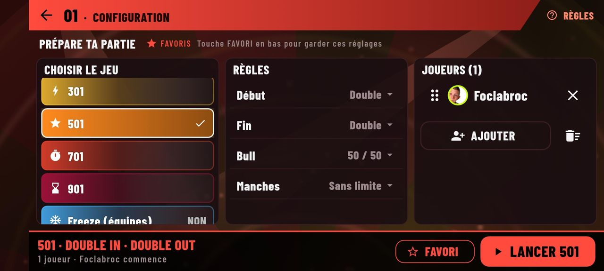
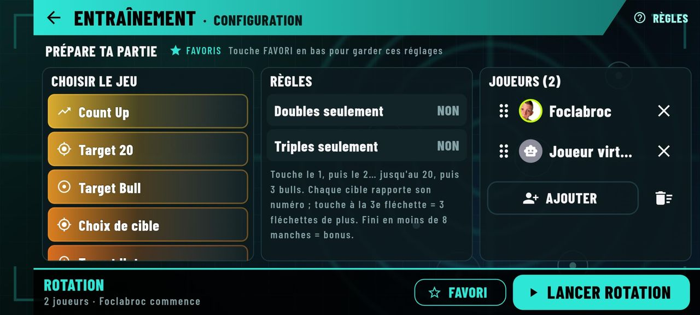
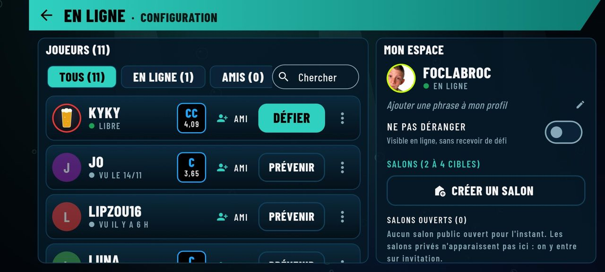
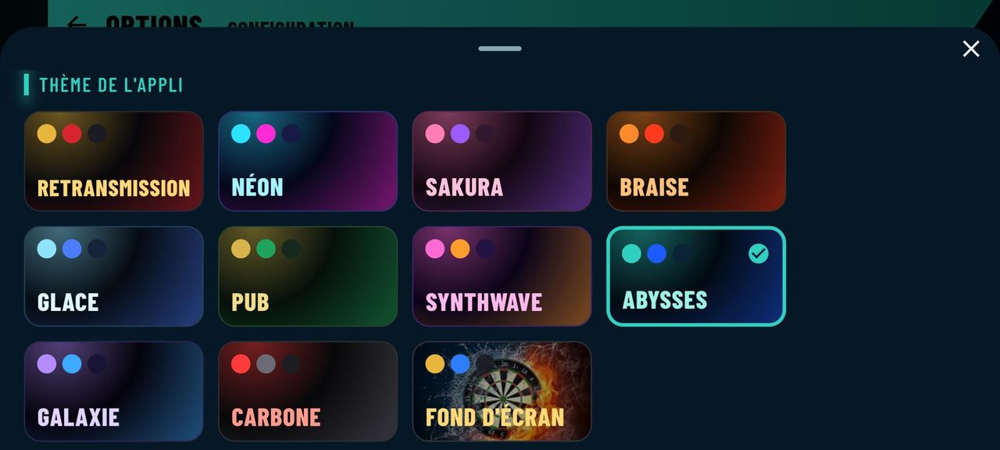
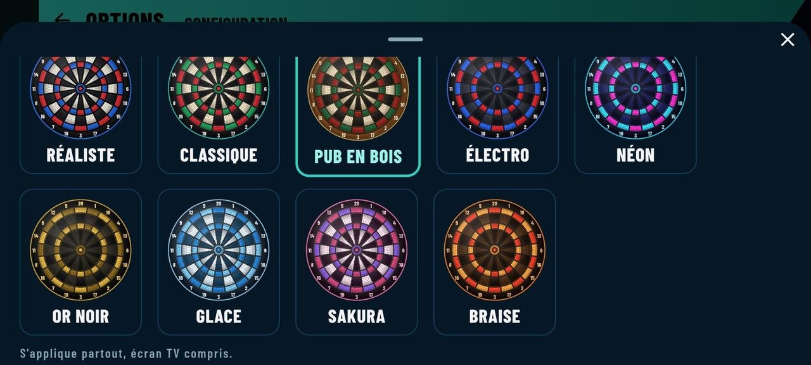
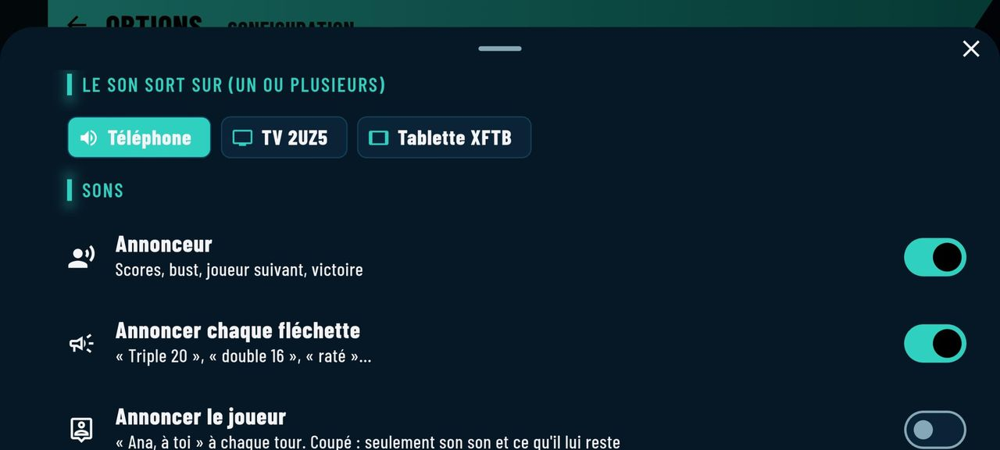

# Foclaboard

**Foclaboard** est une appli Android (Flutter) de fléchettes pour les cibles électroniques **GranBoard** (Dash et 3s), connectées en Bluetooth, et aussi les **VDarts** (H2, H3, H4, MINI ; pas encore essayé sur une vraie VDarts). Elle se joue en paysage, téléphone ou tablette posé à côté de la cible. Les comptes, stats, rangs et classements sont sur le serveur maison. Le même APK sert aussi d'écran sur une Android TV ou une tablette, et permet de jouer en ligne, chacun chez soi.

## Sommaire

- [Installation](#installation)
- [Démarrer](#démarrer)
- [Les jeux](#les-jeux)
- [Préparer une partie](#préparer-une-partie)
- [Pendant la partie](#pendant-la-partie)
- [Joueurs, stats et rangs](#joueurs-stats-et-rangs)
- [Jeu en ligne](#jeu-en-ligne)
- [Tournois](#tournois)
- [Écran TV](#écran-tv)
- [Personnalisation](#personnalisation)
- [Son et annonceur](#son-et-annonceur)
- [Options et outils](#options-et-outils)
- [Serveur](#serveur)
- [Build](#build)

## Installation

### Sur le téléphone ou la tablette

1. Télécharge la dernière version : **[Foclaboard.apk](https://github.com/foclabroc/granboard_app/releases/latest/download/Foclaboard.apk)** (ou la page [Releases](https://github.com/foclabroc/granboard_app/releases/latest)). Un joueur qui a déjà l'appli peut aussi te montrer le **QR code** (Options › Partager l'appli) ou te l'envoyer par **SMS**.
2. Ouvre le fichier téléchargé. La première fois, Android demande d'autoriser l'installation depuis le navigateur (ou le gestionnaire de fichiers) : accepte, puis **Installer**.
3. Ensuite, les mises à jour se font depuis l'appli : elle prévient au lancement quand une nouvelle version est sortie.

### Sur une Android TV / Google TV (avec LocalSend)

La TV n'a pas de navigateur pratique : le plus simple est d'envoyer l'APK depuis le téléphone avec **LocalSend** (gratuit, sur le Play Store du téléphone **et** de la TV).

1. **Sur la TV** : Play Store › cherche **LocalSend** › Installer, puis ouvre-le une fois (il affiche le nom de la TV).
2. **Sur la TV, autorise LocalSend à installer des applis** : Paramètres › Applis (ou Système) › Sécurité et restrictions › **Sources inconnues** › active **LocalSend**. Sur certaines Google TV, ce menu n'apparaît qu'après avoir activé le mode développeur : Paramètres › Système › À propos › appuie 7 fois sur **Build de l'OS Android TV**. Le chemin exact change un peu selon la marque de la TV.
3. **Sur le téléphone** : installe LocalSend aussi, et télécharge [Foclaboard.apk](https://github.com/foclabroc/granboard_app/releases/latest/download/Foclaboard.apk).
4. Téléphone et TV sur le **même Wi-Fi**, LocalSend ouvert des deux côtés. Sur le téléphone : **Envoyer** › **Fichier** › choisis `Foclaboard.apk` › touche la TV dans la liste.
5. **Sur la TV** : accepte la réception, puis ouvre le fichier reçu (dans LocalSend, l'historique ou le dossier Téléchargements) › **Installer**.
6. Lance **Foclaboard** depuis l'écran d'accueil de la TV : il démarre directement en **mode écran** et affiche un code à 4 caractères. Voir [Écran TV](#écran-tv) pour le relier au téléphone.

Pour une mise à jour de la TV, refais simplement les étapes 3 à 5 avec la nouvelle version : l'appli est remplacée, le code et les réglages sont gardés.

## Démarrer

1. Ferme l'appli GranBoard officielle : la cible n'accepte qu'une connexion Bluetooth à la fois.
2. **Premier lancement** : crée ton profil principal (pseudo + code à 4 chiffres), ou « J'ai déjà un compte », ou « Plus tard ».
3. Touche la pastille **cible** en haut de l'accueil, puis ta GranBoard. Ensuite l'appli s'y reconnecte toute seule.
4. Choisis une tuile, règle la partie, **LANCER**. Le bouton de la cible (ou « Suivant ») passe au joueur suivant.

L'accueil, en 8 tuiles : **01**, **Cricket**, **Party**, **Tournois**, **Medley**, **Entraînement**, **En ligne**, **Options**. La barre du haut donne accès aux joueurs du téléphone, aux **STATS** (classements), à la **TV**, au **SON** et à ton **PROFIL** (photo + rang).

## Les jeux

Chaque jeu se règle dans son tableau de configuration (voir plus bas). Le bouton **RÈGLES** affiche les règles complètes selon les réglages choisis. Les règles relevées et les choix faits sont aussi dans `docs/regles_granboard.md`.

### 01 (X01)

Partir de 301, 501, 701 ou 901 et descendre **exactement à 0**.

- **Début** : Open (tout compte), Double (il faut un double pour commencer) ou Master (double, triple ou bull).
- **Fin** : Open, Double ou Master. Dépasser, tomber à 1 en Double/Master ou finir sur une mauvaise fléchette = **bust** : retour au score du début de la manche.
- **Bull** : 25/50 ou 50/50 (le 25 vaut alors 50 et compte comme un double).
- **Manches** : sans limite ou limitées ; à la limite, le plus petit reste gagne.
- **Freeze (équipes)** : 2 équipes de même taille qui jouent en alternance. Une équipe dont le total restant dépasse celui de l'adversaire est **gelée** : elle ne peut pas finir. Le joueur qui finit fait gagner son équipe.
- **Fins conseillées** : la combinaison conseillée et 2 autres s'affichent dès qu'une fin est possible, avec la zone à viser sur la cible.

### Cricket

Fermer les numéros (3 marques : simple = 1, double = 2, triple = 3) puis marquer des points dessus. 2 à 10 joueurs, en individuel ou en **équipes**, avec une limite de manches (20 par défaut).

| Variante | Règle |
|---|---|
| **Cricket** | 20 à 15 et bull. Un numéro fermé rapporte des points tant qu'un adversaire ne l'a pas fermé. Tout fermer avec le meilleur score pour gagner. |
| **Cut Throat** | Les points vont aux adversaires qui n'ont pas fermé le numéro : le plus petit score gagne. |
| **Cricket caché** | 7 cibles tirées au hasard (1 à 20 et bull), cachées : touche un numéro pour le découvrir. |
| **Cut Throat caché** | Cibles cachées + points donnés aux adversaires. |
| **Wildcard** | 6 numéros tirés entre 7 et 20 (+ bull) ; tant que personne ne les a marqués, ils changent à chaque manche. |
| **No Score** | Pas de points : le premier qui ferme tout gagne. |
| **Triple Only** | 20 à 15 sans bull, seuls les triples comptent (un triple ferme). |
| **Mickey Mouse** | 20 à 12, puis Doubles, Triples et bull. Un double ou un triple inutile marque sur « D » ou « T ». |

Deux vues au choix (bouton VUE) : **classique** façon GranBoard (numéros au centre, joueurs de chaque côté) ou **en lignes** (un joueur par ligne, idéale à beaucoup).

### Medley

Un match en plusieurs **legs** : 3, 5, 7, 9, 11 ou 13 legs, le premier à la majorité gagne. Le jeu de chaque leg se choisit : 301, 501, 701, 901 ou Cricket. Le joueur qui commence tourne à chaque leg. Les règles du 01 (début, fin, bull) valent pour tous les legs de 01.

### Entraînement (18 jeux)

À jouer seul ou à plusieurs. Le meilleur score de chaque jeu est gardé et classé.

| Jeu | Règle |
|---|---|
| **Count Up** | Chaque fléchette rapporte sa valeur : le plus gros total gagne. 33 manches = défi des 99 fléchettes. |
| **Target 20** | Vise le 20 : simple = 1 touche, double = 2, triple = 3. Le premier à l'objectif gagne. |
| **Target Bull** | Vise le bull : 25 = 1 touche, 50 = 2. |
| **Choix de cible** | Choisis ta cible (et changes-en avant ta 1re fléchette) ; simple = 1, double = 2, triple = 3. |
| **Target Hat** | Hat trick : tes 3 fléchettes de la manche dans la cible choisie. |
| **Target Horse** | White Horse : 3 triples sur 3 numéros différents du Cricket dans la même manche. |
| **Half It** | Départ à 40. 9 manches (15, 16, doubles, 17, 18, triples, 19, 20, bull) ; aucune touche = score divisé par 2. |
| **Delta Shoot** | Comme Half It sur 16 manches, jusqu'au double bull. |
| **Rotation** | Le 1, puis le 2… jusqu'au 20, puis 3 bulls. Option doubles ou triples seulement. |
| **Shoot Force** | 1 à 20 puis bull : chaque touche vaut sa valeur × ta série. 3 triples = +3 000, bull 10 000, double bull 100 000. |
| **Oniren** | Une cible au hasard par manche : 2 simples + 1 double ou triple dessus. Manche ratée = une vie en moins (3 vies). |
| **CR Count Up** | 20, 19… 15, bull, puis au choix : points = valeur × marques. |
| **CR Multiple** | 20 à 15 puis bull, fléchettes ×1, ×2, ×3, manches bonus ; rien touché = pénalité. |
| **Bob's 27** | Départ à 27, D1 à D20 puis double bull : + le double à chaque touche, - sa valeur si aucune. Options Hard et doubles pairs. |
| **Finition 121** | Finis 121 en Double Out en 9 fléchettes : réussi = +1, raté = -1. Le premier à 125 gagne. |
| **Spider** | Abats des araignées en ramenant leur nombre à 0 pile, avec bonus. 15 manches. |
| **Pirates** | Bull seulement : un navire coule tous les 200 points, puis chance au trésor. 15 manches. |
| **Contre la montre** | Finis ton 01 le plus vite possible : le chrono tourne pendant tes tours, le meilleur temps gagne. |

### Party (31 jeux)

Des jeux de soirée, la plupart à plusieurs.

| Jeu | Règle |
|---|---|
| **Fun Mission** | Une mission par manche (un triple, 60 points, le bull…). À 2 : mission réussie = une vie prise à l'adversaire. Seul : atteins 8. |
| **All Fives** | Si le total de tes 3 fléchettes est un multiple de 5, tu marques total ÷ 5. Atteins l'objectif pile. |
| **Beyond Top** | Fais plus que le joueur d'avant, sinon une vie en moins (6 vies). |
| **Kick Down** | Course de 0 à 301 (ou 501) pile. Tomber sur le score d'un adversaire le renvoie à 0 ! Dépasser fait perdre des points. |
| **Two Line** | Bingo 5 × 5 : prends des numéros, reprends ceux des autres, fais 2 lignes. |
| **Shanghai** | Manche 1 = le 1, manche 2 = le 2… Simple + double + triple dans la manche = SHANGHAI, victoire immédiate. |
| **Hyper Bull** | Tout l'intérieur de l'anneau des triples vaut 50, le bull 75, le centre 100. 8 manches. |
| **Cache-cache** | 12 fenêtres cachent 6 animaux gentils et 1 méchant : ouvre-les en touchant leur numéro. |
| **Killer** | Chacun son numéro : deviens KILLER sur le tien, puis retire des vies aux autres. Le dernier en vie gagne. |
| **Treasure Hunt** | Chaque numéro cache un trésor ou un piège (crânes, grenade, voleurs). Manches à trésors doublés ou inversés. |
| **Morpion** | Grille de numéros : 4 marques pour prendre une case, aligne tes cases. |
| **Baseball** | 9 manches : manche 1 = le 1… Simple = 1 point, double = 2, triple = 3. |
| **Golf** | Trou 1 = le 1… Ta meilleure fléchette compte : triple = 1 coup, double = 2, simple = 3, rien = 5. Le plus petit total gagne. |
| **Scram** | Une équipe ferme les numéros pendant que l'autre marque sur ceux encore ouverts, puis on échange. |
| **Football** | Touche le bull pour avoir le ballon, puis chaque double = un but. Le premier à 5 buts gagne. |
| **Patate chaude** | Une bombe sur un numéro, avec une mèche : touche son numéro pour la passer. Si elle explose chez toi, une vie en moins. |
| **Le Chat et la Souris** | À 2 : la souris fait le tour de la cible avec quelques cases d'avance, le chat doit la rattraper. |
| **Paint** | Chaque fléchette peint sa zone à ta couleur (et la vole aux autres) ; touche une zone à toi pour la protéger. |
| **Bowling** | 10 frames, 2 fléchettes pour faire tomber 10 quilles (T20 = strike), strikes et spares comme au bowling. 300 au maximum. |
| **Grand Prix** | Course de voitures : ton numéro fait avancer ta voiture, le bull donne un turbo, le numéro d'un adversaire lui fait faire un tête-à-queue. |

Les 11 jeux « arcade » (v0.6.27) ont chacun leur propre écran animé à la place de la cible (la cible reste en petit à côté) :

| Jeu | Règle |
|---|---|
| **Tir à la corde** | Chaque point tire la corde vers ton camp (gauche ou droite, en équipes à plus de 2). Le premier camp à son but gagne. |
| **Coffre-fort** | Un code de 10 à 50 par manche : descends-le à 0 pile en 3 fléchettes pour piller le coffre. En dessous : alarme. |
| **Fight Club** | 3 numéros chacun : frappe ceux des adversaires, soigne-toi sur les tiens, le bull touche tout le monde. Dernier debout gagne. |
| **Puissance 4** | Le numéro touché choisit la colonne (7-14-bull = 7e colonne) ; aligne 4 pions. |
| **Serpents et échelles** | L'anneau fait avancer (bull 6 … double 1) ; échelles, serpents, case 100 pile. |
| **Boules** | Le cochonnet au centre, 1 fléchette chacun son tour : la boule la plus près gagne la mène. |
| **Conquérant** | Prends les numéros voisins de tes régions, casse les boucliers adverses, tiens le hub (bull) pour attaquer partout. |
| **Test Match** | Le cricket (le sport) : au bâton, les points au-dessus de 40 sont des courses ; au lancer, le bull fait tomber les guichets. |
| **Snooker** | Une rouge (1-15) puis une couleur (16 à bull), puis les couleurs dans l'ordre ; une faute donne des points à l'adversaire. |
| **8 Ball Pool** | 7 billes (numéros) chacun : tu gardes la main tant que tu en empoches, puis la 8 au bull. |
| **Zombies** | Coopératif : abats chaque zombie en touchant sa cible exacte (T17, D8…) avant qu'il morde la base. |

### Joueurs virtuels et invités

- **Joueur virtuel** : un bot qui vise vraiment (fins conseillées en 01, numéros à fermer au Cricket, cibles des entraînements) avec une précision calée sur le niveau des joueurs humains de la partie. Il joue tout seul quand c'est son tour.
- **Invité** : joue sans compte et sans stats.

## Préparer une partie

Chaque tuile ouvre un **tableau de configuration** en 3 colonnes, aux couleurs du jeu :

- **Choisir le jeu** : tuiles en bandes de couleur, en dégradé du haut vers le bas de la liste.
- **Règles** : les réglages du jeu choisi, avec un résumé des règles.
- **Joueurs** : l'ordre de jeu (à glisser), les équipes A / B, **AJOUTER** (mes joueurs, invité, joueur virtuel, nouveau compte ; les joueurs déjà dans la partie sont affichés en pastilles en haut de la fenêtre) et la corbeille pour tout vider.
- **★ FAVORI** : garde le jeu et ses règles, à retrouver en un toucher dans la ligne FAVORIS.
- Le bandeau du bas résume la partie et lance le jeu.

Chaque famille de jeux a son propre **thème** (arène pour le 01, ardoise pour le Cricket, confettis pour la Party…), qui suit jusque dans la partie et sur la TV.

## Pendant la partie

- **Cible animée** : fléchettes plantées et numérotées à la couleur du joueur, cases à viser éclairées, effets lumineux sur les numéros (simple, double, triple, bull, bust, victoire).
- **Fins conseillées** en 01, avec la zone à viser sur la cible.
- **Bandeau « AU TOUR DE … »** avec la photo et la couleur du joueur, et son **son du tour**.
- **Adversaires virtuels** : 9 personnages de niveau fixe (du grand débutant au Boss) à battre l'un après l'autre pour débloquer le suivant, en plus du joueur virtuel qui s'adapte.
- **Intro de chaque partie** façon retransmission TV : jeu, règles, nombre de joueurs et ordre de jeu (désactivable dans les options).
- **Vidéos** pour les coups (Triple 20, Bull, Double Bull) et les récompenses (Low Ton, High Ton, Ton 80, Hat Trick, 3 in the Black, 3 in a Bed, White Horse), en plusieurs styles tirés au hasard (vidéos d'origine + 3 styles en motion design avec bruitages : Impact, Synth, Or).
- **Annuler** revient en arrière, **Raté** compte une fléchette hors cible.
- **AUTO** : passe au joueur suivant tout seul 5 s après la 3e fléchette.
- **Résultats** ouverts tout seuls en fin de partie : podium, moyennes, MPR, meilleures manches, puis **REJOUER** ou **MENU PRINCIPAL**.
- **Reprise** : une partie coupée (appli fermée, téléphone éteint) est proposée au lancement suivant.
- **Hors ligne** : les stats des parties jouées sans internet sont gardées et envoyées dès que le serveur revient (pastille nuage sur l'accueil).
- Une partie jouée à la maison avec un compte peut être **regardée en direct** par les autres joueurs (voir [Jeu en ligne](#jeu-en-ligne)).

## Joueurs, stats et rangs

- **Comptes** : pseudo + code à 4 chiffres, gardés sur le téléphone, utilisables sur plusieurs téléphones. Le **profil principal** (★) est celui qui apparaît en ligne.
- **Fiche d'un joueur**, en 3 onglets :
  - **STATS** : 01 (parties, victoires, moyenne, fléchettes, meilleure fin, meilleure manche, 100+, 180), Cricket (parties, victoires, MPR, meilleure manche), meilleurs scores d'entraînement, et le **rang détaillé** (anneaux 01 / général / Cricket, PPR / MPR sur 80 % et 100 % des parties, ce qu'il faut pour le rang suivant, courbe, historique complet des parties).
  - **PERSONNALISER** : photo (galerie, appareil photo ou 16 avatars fléchettes), couleur (16, dont arc-en-ciel), son du tour (21 sons ou sa propre voix enregistrée), cible préférée, prononciation du pseudo par l'annonceur, profil principal, retirer du téléphone.
  - **PARTIES** : les dernières parties.
- **Rangs façon GranBoard** : de C à GM, avec une note sur 20 (« C 3,78 »), affichés à côté du nom dans tous les jeux.
- **Classements** (bouton STATS) : rang, victoires, moyenne, 180, meilleure fin, meilleure manche, MPR, victoires au Cricket, chaque jeu d'entraînement et de Party ; filtres TOUS / MES JOUEURS / AMIS. Toucher un joueur ouvre ses stats.
- **Mes réglages sur mon compte** : thème, cible, son, favoris, fond d'écran… sauvegardés sur le compte et proposés sur un nouveau téléphone.

## Jeu en ligne

- **Joueurs** : tous les comptes du serveur avec leur état (libre, en partie, ne pas déranger, vu il y a…), leur rang, filtres TOUS / EN LIGNE / AMIS et recherche.
- **Amis** : demandes d'ami, bilan face à face (victoires / défaites), titres gagnés (Roi du 180, Finisseur de légende…).
- **DÉFIER** un joueur libre : 1 contre 1 ou **2 contre 2** (une maison par équipe), au jeu de ton choix ; l'autre a 45 s pour accepter. **REVANCHE** à la fin.
- **PRÉVENIR** un joueur absent que tu veux jouer, ou lui proposer un **rendez-vous**.
- **REGARDER** la partie d'un joueur en direct, en ligne ou à la maison.
- **Salons** de 2 à 4 cibles (maisons), publics ou privés sur invitation, avec plusieurs joueurs par maison.
- **Mon espace** : ta phrase de profil, **Ne pas déranger**, tes salons et invitations.
- **Bloquer** un joueur : il ne peut plus te défier ni te regarder.
- **Vidéo** : la caméra de chaque adversaire dans une vignette déplaçable (caméra, micro, caméra arrière). Elle passe en direct entre les téléphones (WebRTC) et, si besoin (4G, certaines box), par le relais TURN du serveur maison : voir `tools/turn/README.md`.

## Tournois

- **À la maison** : 2 à 16 joueurs (comptes et invités), tableau à élimination directe, matchs joués à la suite sur la même cible, tableau affiché sur la TV.
- **En ligne** : 4, 8 ou 16 places, chacun chez soi ; inscriptions, tirage, bannière « TON MATCH » pour défier ton adversaire, vainqueur envoyé automatiquement.
- Jeu des matchs au choix à la création : 01, Cricket ou Medley.

## Écran TV

Installe le même APK sur l'Android TV, ou passe une tablette en « mode écran » : elle affiche un code. Sur le téléphone : bouton **TV** › entre le code.

- L'écran montre la partie en grand, les bandeaux, les vidéos, le joueur suivant (« ENSUITE ») et les fins conseillées.
- **Écran d'attente** : cible qui flotte, classements du serveur et dernières parties des joueurs du téléphone.
- **Plusieurs écrans** à la fois (TV + tablette…), reliés par le serveur et par le **Wi-Fi local**, même sans internet.
- **Le son sort sur** le téléphone, un ou plusieurs écrans.
- **Caméra sur un écran** : filmer la cible avec la tablette ou le téléphone et l'afficher sur la TV (coin ou plein écran).
- Réglages pour les TV peu puissantes : animations allégées, moteur de rendu Skia, vidéos en décodage logiciel.

## Personnalisation

| | |
|---|---|
| **11 thèmes** : Retransmission, Néon, Sakura, Braise, Glace, Pub, Synthwave, Abysses, Galaxie, Carbone, et **Fond d'écran** (9 images fournies, au hasard, ou tes photos). Fonds animés, appliqués partout, TV comprise. |  |
| **9 cibles** : Réaliste, Classique, Pub en bois, Électro, Néon, Or noir, Glace, Sakura, Braise. Une cible générale, et une cible par joueur qui le suit sur tous les téléphones, la TV et en ligne. |  |

## Son et annonceur

- **Le son sort sur** : un ou plusieurs appareils (téléphone, TV, tablette).
- **Annonceur** en voix française enregistrée : scores, ce qu'il reste, bust, joueur suivant, victoire, fins (« Fin à 120 », « Plus haute fin de la soirée »), 180 de la soirée, « Match point », « X prend la tête ! ».
- **Annoncer chaque fléchette** (« Triple 20 », « double 16 », « raté »…), **Annoncer le joueur** (« Ana, à toi »), **Commentaires et chambrage**.
- Pseudos lus par la synthèse vocale, avec la prononciation choisie dans la fiche du joueur.
- **Bruitages** et **musique des menus** (5 morceaux enchaînés au hasard, le même sur le téléphone et la TV).

| Fichier | Quand |
|---|---|
| `assets/sounds/*.ogg` | Bruitages (fléchette, double, triple, bull, bust, ton, 180, victoire) |
| `assets/sounds/turn/*.ogg` | Sons du tour des joueurs (21) |
| `assets/music/menu1.ogg` … `menu5.ogg` | Musique des menus (morceaux Pixabay) |
| `assets/voice/` | Annonces enregistrées (`tools/make_voice.py`, voix Piper) |
| `assets/hits/` | Vidéos des coups T20 / Bull / Double Bull (`tools/make_hits.sh`, motion design : `tools/motion_hits/make.py`) |
| `assets/awards/` | Vidéos des récompenses (Ton 80, Hat Trick, 3 in the Black… ; motion design : `tools/motion_hits/make.py`) |

## Options et outils

La tuile **OPTIONS** regroupe les joueurs du téléphone et tous les réglages :

- **Thème**, **style de cible**, **son**, **écran TV**.
- **Cible** : choix de la GranBoard ou de la VDarts, **calibration** (pour une cible qui ne donne pas les bons numéros), **diagnostic** des trames Bluetooth.
- **Lumières de la 3s** : la cible s'allume selon le jeu (numéros à viser, bust, 180, victoire), animation d'attente sur les numéros hors partie, couleur des numéros réglable).
- **Animation du contour de la cible** : 12 styles au choix dans les options (comète rapide, double comète, chenillard, arc-en-ciel…), aussi sur l'écran TV.
- **Partager l'appli** : QR code ou SMS avec le lien de la dernière version.
- **Mise à jour** : la dernière version GitHub est vérifiée au lancement et s'installe depuis l'appli.

## Serveur

Stats, rangs, classements, photos, sons, cibles des joueurs, réglages, écran TV, jeu en ligne, amis, salons, tournois et parties en direct sont sur le serveur maison (PostgreSQL + PostgREST, partagé avec Pixel Trade, objets préfixés `gb_`). Fichiers SQL dans `sql/`, à lancer dans l'ordre (tous relançables) :

1. `2026-11-11_comptes_stats.sql`
2. `2026-11-11_salon_tv.sql`
3. `2026-11-11_cricket.sql`
4. `2026-11-11_entrainement.sql`
5. `2026-11-11_photo_son.sql`
6. `2026-11-12_en_ligne.sql`
7. `2026-11-12_rangs.sql`
8. `2026-11-12_tournois.sql`
9. `2026-11-13_double.sql`
10. `2026-11-13_cible.sql`
11. `2026-11-13_camera_ecran.sql`
12. `2026-11-15_reglages.sql`
13. `2026-11-15_amis.sql`
14. `2026-11-15_social.sql`
15. `2026-11-17_historique.sql`
16. `2026-11-17_salons.sql`
17. `2026-11-18_volatile.sql`
18. `2026-11-18_direct.sql`

`psql -U postgres -d postgres -f fichier.sql`

## Build

- En local : `flutter run`
- APK : onglet **Actions → APK Android → Run workflow** (« publier » coché = release GitHub, proposée en mise à jour dans l'appli).
- Nouveautés de chaque version : `CHANGELOG.md`.
